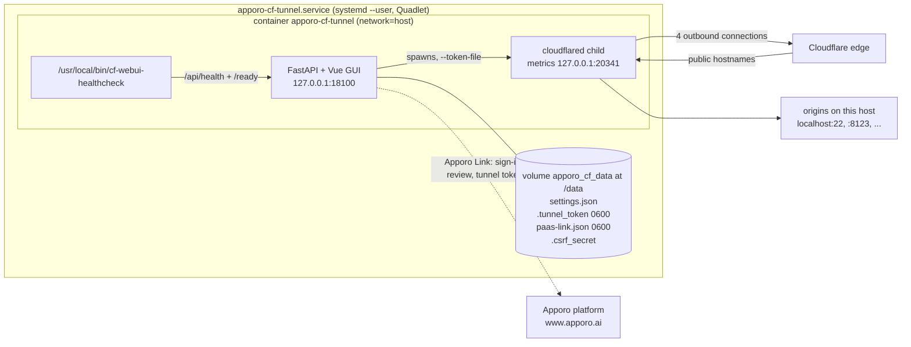

<p align="center">
  
</p>

<h1 align="center">Apporo CF Tunnel Web</h1>

<p align="center">
  <strong>Run a Cloudflare Tunnel from your browser and connect it to an Apporo Security Access. One container, supervised by systemd through Podman Quadlet.</strong>
</p>

<p align="center">
  <a href="README_zh-TW.md">繁體中文</a> &bull;
  <a href="#install">Install</a> &bull;
  <a href="#connect-an-apporo-security-access">Connect</a> &bull;
  <a href="#operate">Operate</a> &bull;
  <a href="#security">Security</a> &bull;
  <a href="#api-reference">API</a>
</p>

<p align="center">
  
  
  
  
  
  
  
  
  
</p>

---

## Overview

Apporo CF Tunnel Web is the Apporo edition of
[WOOWTECH/Woow_cloudflare_tunnel_webgui](https://github.com/WOOWTECH/Woow_cloudflare_tunnel_webgui),
forked from upstream 1.2.1. It can do everything upstream can. The difference is where the
platform link goes: the **Apporo Link** page connects this host to a **Security Access** on
the Apporo platform ([www.apporo.ai](https://www.apporo.ai)), not to WOOW PaaS.

A single container runs a FastAPI + Vue web GUI **and the `cloudflared` connector it
supervises as a child process**. Connect an Apporo Security Access, paste a tunnel token, or
log in to Cloudflare from the GUI, and the tunnel runs. There is no Podman socket, no second
container and no CLI.

Features are the same as upstream 1.2.1, which matches WOOW's Cloudflared Home Assistant add-on
1.1.1: the guided platform link with a per-route public or Access-protected review,
edge-connection status, redacted logs, the run-parameter allow-list and the credential-file
guard. Features that need the HA Supervisor are only in the add-on: Ingress,
`external_hostname` and `nginx_proxy_manager`. Here, a route or a catch-all does the same job.

`scripts/install.sh` installs it as **rootless Podman Quadlet units under user systemd**. It
starts at boot (with linger), restarts when it crashes, and also restarts when the *tunnel*
dies while the backend is still up.

It can run on the same host as WOOW's web GUI. Every name, port and volume is different
(see [Running next to WOOW's web GUI](#running-next-to-woows-web-gui)).



**Liveness.** The container healthcheck requires the backend's `/api/health`. When a tunnel
is configured, it also requires `cloudflared`'s `/ready` with at least one edge connection.
Checks run every 30s after a 60s start period. Three failures in a row make podman kill the
container (`HealthOnFailure=kill`). `Restart=always` brings it back, and the app reconnects
the tunnel. From detection to recovery takes about 1.5-2.5 minutes.

## Differences from upstream

| | Upstream 1.2.1 (WOOW) | This fork 1.0.0 (Apporo) |
|---|---|---|
| Platform link | WOOW PaaS, `https://aiot.woowtech.io` | Apporo Security Access, `https://www.apporo.ai` |
| Device label on the platform | `Woow Cloudflared (Podman)` | `Apporo CF Tunnel Web (Podman)` |
| OAuth client, scopes, API paths | `woow-ha-smart-home`; `workspace:read security-access:read security-access:tunnel` | unchanged |
| UI | Traditional Chinese and English, Cloudflare orange `#F6821F` | English, Apporo gold `#8B6B24` |
| systemd unit / container | `woow-cf-tunnel.service` / `woow-cf-tunnel` | `apporo-cf-tunnel.service` / `apporo-cf-tunnel` |
| Env file | `~/.config/woow-cf-tunnel/woow-cf-tunnel.env` | `~/.config/apporo-cf-tunnel/apporo-cf-tunnel.env` |
| Image tag | `localhost/woow-cf-tunnel:<VERSION>-<sha12>` | `localhost/apporo-cf-tunnel:<VERSION>-<sha12>` |
| Data volume (default) | `cf_data` | `apporo_cf_data` |
| GUI / metrics / auth proxy | `127.0.0.1:18000` / `:20241` / `:8888` | `127.0.0.1:18100` / `:20341` / `:8988` |
| Legacy migration | `scripts/migrate-legacy.sh` | none; WOOW resources are never touched |

## Requirements

- Ubuntu 24.04 or similar, **rootless podman 4.9.3+** (`sudo apt install podman`)
- a user systemd session with linger (`sudo loginctl enable-linger $USER`)
- an Apporo account with a Security Access, or any Cloudflare tunnel token, or a
  Cloudflare account for the GUI login flow
- git, and enough space to build the image (~250 MB)

## Install

```bash
git clone https://github.com/WOOWTECH/apporo_cf_tunnel_web.git
cd apporo_cf_tunnel_web

scripts/install.sh          # first run: writes ~/.config/apporo-cf-tunnel/apporo-cf-tunnel.env and stops
$EDITOR ~/.config/apporo-cf-tunnel/apporo-cf-tunnel.env
scripts/install.sh          # builds the image, installs the units, starts, smoke-tests
```

The image is **built locally** from this checkout and tagged
`localhost/apporo-cf-tunnel:<VERSION>-<git-sha12>`. The unit pins that tag with `Pull=never`.
Like upstream since 1.1.0, this repo is Quadlet-only. It has no compose file.

`~/.config/apporo-cf-tunnel/apporo-cf-tunnel.env` holds install-time settings only, no secrets:

| Key | Default | Meaning |
|---|---|---|
| `CF_DATA_VOLUME` | `apporo_cf_data` | the data volume to create, or to keep using on a reinstall. Never point it at a WOOW volume such as `cf_data`; an existing volume is used only when podman says it is this app's |
| `UVICORN_PORT` | `18100` | GUI/API port; the unit always binds it to 127.0.0.1 |
| `CF_METRICS_ADDR` | `127.0.0.1:20341` | cloudflared `--metrics`; must stay on loopback |
| `AUTH_LISTEN` | `127.0.0.1:8988` | listen address of the optional Basic-auth proxy |
| `AUTH_HTPASSWD` | `%h/.config/apporo-cf-tunnel/htpasswd` | its password file |

Values are rendered into the unit files at install time. The containers never read this
file. After you edit it, run `scripts/upgrade.sh` (tunnel) or `scripts/install.sh` (auth
proxy). `install.sh` refuses a port that another process already holds, and WOOW's default
ports (18000, 20241, 8888) even when nothing holds them. It names the port.

### Open the GUI

It listens on 127.0.0.1 only. From your workstation:

```bash
ssh -L 18100:127.0.0.1:18100 <this host>
# then open http://localhost:18100
```

Then connect an Apporo Security Access (next section), paste a tunnel token on the Config
page, or use the Setup page to log in to Cloudflare.

## Connect an Apporo Security Access

A Security Access is the Apporo platform's tunnel service. The platform creates the
Cloudflare tunnel and its public hostnames (application routes), and can add Cloudflare
Access protection to each route. This GUI runs the connector for it on your host.

First create the Security Access on [www.apporo.ai](https://www.apporo.ai): a workspace, a
plan and at least one route. Plans, trials and payment are all handled on the portal. This
GUI never charges anything.

There are two ways to connect.

### Option 1: the Apporo Link page (recommended)

1. **Sign in.** Open **Apporo Link** in the navigation bar and get a device code. Open the
   device page it links to (the platform returns `https://www.apporo.ai/device`), sign in to
   your Apporo account, enter the code and allow the connection. The code is valid for up to
   15 minutes, and the page updates by itself. This page never asks for a tunnel token.
2. **Pick the Security Access.** Choose the workspace, then the Security Access. If the
   workspace has none yet, the page links to the portal so you can create one.
3. **Review the routes.** The page checks the service and every route before you can
   connect:
   - the service is active, its subscription is valid and its tunnel exists;
   - it is not bound to another device and has no second connector;
   - every route has a public hostname and an internal service URL;
   - a route **with** Access needs a plan with Access seats, at least one login method, and
     an allow rule that names specific emails or an email domain. Broad rules (everyone, IP
     ranges, countries, bypass) are refused;
   - a route **without** Access (public) works without seats. But anyone who knows the
     hostname reaches your service, so the service's own login must be on. The page lists
     these routes and asks you to confirm before it connects.

   Fix what the page reports on the portal (the Security Access's **Application** tab for
   routes, its **Access** tab for protection), then check again.
4. **Connect.** The page checks once more. It then fetches the tunnel credential, binds this
   host on the platform as `Apporo CF Tunnel Web (Podman)`, and starts cloudflared in token
   mode. If the start fails, it restores the previous local settings and releases the binding.

After you connect, the page can refresh the connection status and test the public hostnames
from outside. The test is an anonymous request. It shows whether a hostname answers with the
Access login, a public response, a block or an origin error. It does not prove that a given
person can sign in. After you change a route's protection, the platform publishes the change
only once a connector is live. Until then the hostname answers 503, and the page shows the
route as *awaiting publication*.

While the link is active, the token and the mode on the Config page are locked.
**Disconnecting** on the Apporo Link page stops cloudflared, makes sure it has exited, removes
the token, clears the local routes, and releases the binding on the platform. If the platform
cannot be reached, the release stays pending: the page offers a retry, and the app also
retries at its next start. Disconnecting does not delete hostnames, DNS records, Access
settings or the subscription. Do that on the portal.

You can revoke the account authorization on the same page when nothing is connected.

### Option 2: paste the tunnel token

1. On [www.apporo.ai](https://www.apporo.ai), open your workspace, then the Security Access.
   On its **Overview** tab, find **Connect a machine** > **Tunnel token**, and reveal or copy
   the token. Treat it like a password.
2. In the GUI, open **Config** and set **Mode** to `token`. Paste the token into
   **Tunnel Token** (a whole `cloudflared service install …` command also works), then press
   **Save & Apply**.

In token mode the routes come from the platform. Manage them on the portal's Application
tab; the local routes on the Config page are not used. The token is stored in
`/data/.tunnel_token` (mode 0600) and is only ever shown as `********`. To stop using it,
remove the token on the Config page. While a pasted token is set, the Apporo Link page
refuses to connect; remove the token first if you want to switch.

Run a token on one machine at a time. When two connectors run the same token, Cloudflare may
keep sending visitors to either of them, often the old one. Stop the old connector as soon as
the new one is up.

### Route targets

cloudflared runs with host networking, so a route's internal service URL points at a service
on this host, for example `http://localhost:8123` (Home Assistant) or `http://localhost:80`
(Nginx Proxy Manager). A 502 usually means that nothing listens on that port; check with
`curl -I http://localhost:<port>` on the host. A 400 from Home Assistant means it rejects
proxied requests: in its `http:` configuration, set `use_x_forwarded_for: true` and add `127.0.0.1`
and `::1` to `trusted_proxies`.

### Your own Cloudflare account

The GUI also works without Apporo, as upstream does. Paste any tunnel token from the
Cloudflare dashboard on the Config page (token mode). Or use the Setup page to log in to
Cloudflare, create a tunnel, and manage its routes and DNS from this host (local-managed
mode).

## Running next to WOOW's web GUI

This fork can be installed on a host that already runs WOOW's Cloudflare Tunnel Web GUI.
The two installs have no unit, container, volume, port or file in common:

- unit and container: `apporo-cf-tunnel` (WOOW: `woow-cf-tunnel`)
- image: `localhost/apporo-cf-tunnel` (WOOW: `localhost/woow-cf-tunnel`)
- data volume: `apporo_cf_data` (WOOW: `cf_data`)
- ports: 18100 / 20341 / 8988 (WOOW: 18000 / 20241 / 8888)
- directories: `~/.config/apporo-cf-tunnel`, `~/.local/state/apporo-cf-tunnel`,
  `~/backups/apporo-cf-tunnel`. The vendored Quadlet library keeps each app's install
  manifest and lock in its own subdirectory of `~/.local/state/woow-quadlet/` (here
  `apporo-cf-tunnel/`).

**There is no legacy migration.** The Apporo scripts never detect, stop, adopt, migrate or
remove anything that belongs to WOOW: `woow-*` units and containers, `cf-tunnel-webgui*`, the
`cf_data` volume or `~/.config/woow-cf-tunnel`. A fresh install starts with an empty volume of
its own. Keep it that way: if `CF_DATA_VOLUME` pointed at a WOOW volume, the two GUIs would
fight over one token.

The scripts refuse a value that points at WOOW's install before they change anything:

- a WOOW volume name in `CF_DATA_VOLUME` (`cf_data`, `<project>_cf_data`, `woow*`,
  `cf-tunnel-webgui*`), an `AUTH_HTPASSWD` in `~/.config/woow-cf-tunnel`, or WOOW's image for
  `--image`;
- WOOW's default ports, 18000 / 20241 / 8888, for `UVICORN_PORT`, `CF_METRICS_ADDR` or
  `AUTH_LISTEN`, even while WOOW's GUI is stopped. Otherwise its GUI and its connector could
  not bind them on their next start, and its tunnel would stay down;
- an existing volume that podman says is not this app's, whatever its name: labelled for
  another app (WOOW's Quadlet volume carries `io.woowtech.app=woow-cf-tunnel`), created by
  compose, or mounted by any container other than `apporo-cf-tunnel`, running or stopped.
  `install.sh`, `backup.sh`, `restore.sh` and `uninstall.sh --purge` check this before they
  use the volume: Quadlet would otherwise reuse a volume of that name without a word;
- `ENV_FILE=<WOOW's env file>` for `auth-passwd.sh`, whatever htpasswd that file names;
- a `--stage-dir` in a WOOW directory. `install.sh --stage` replaces that directory, so it
  also refuses one that holds more than an earlier stage;
- one of WOOW's backups for `restore.sh`, found by its directory (`~/backups/woow-cf-tunnel`) or
  by the volume its file name was exported from (`cf_data-<timestamp>.tar`). It holds WOOW's
  tunnel token. In the other direction, `backup.sh --dir` never writes into a WOOW directory;
- one of WOOW's upgrade runs, or `CF_STATE_ROOT` set to WOOW's state directory, for
  `upgrade.sh swap|status|commit|abort|--rollback`, and a run whose `run.env` names any unit
  or container but this app's.

The unit and the container the scripts stop, start and check are fixed:
`apporo-cf-tunnel.service` and `apporo-cf-tunnel`. A `NEW_UNIT` or `NEW_CONTAINER` exported in
your shell, for example to tune WOOW's own upgrade, is ignored. So is a `METRICS_ADDR`:
`uninstall.sh` counts edge connections at the address the installed unit uses.

A port that another process already holds is refused too, with `--stage` and while the tunnel
runs. `upgrade.sh` reads its baseline (and a rollback) on the ports the running tunnel was
installed with, and its gate on the new ones. `tests/smoke.sh` only judges this app's own
cloudflared: WOOW's older `cf-tunnel-webgui` connector passes `--token` on its command line,
which is reported, not counted against this install.

Both GUIs can be open in one browser. Browsers share cookies between the ports of one host,
so this GUI's CSRF cookie is `apporo_csrftoken`; WOOW's is `csrftoken`.

To move a tunnel that WOOW's GUI runs today (for example an Apporo token you pasted there
before this fork existed), connect it here first. When the Dashboard here shows edge
connections, remove the token from WOOW's GUI right away.

## Operate

```bash
systemctl --user show apporo-cf-tunnel.service -p ActiveState,SubState,NRestarts
journalctl --user -u apporo-cf-tunnel.service -n 50
podman inspect apporo-cf-tunnel -f '{{.State.Health.Status}}'
curl -s 127.0.0.1:20341/ready            # {"status":200,"readyConnections":4}
tests/smoke.sh                           # the full post-install check list
```

> **If this tunnel carries your SSH session, a restart drops it.** `scripts/install.sh`
> never restarts a running tunnel. `scripts/upgrade.sh` does the restart from a detached
> watchdog that rolls back on its own. Always keep a second way in (a tailnet, the LAN, a
> console) before you touch it remotely.
>
> `upgrade.sh`, `uninstall.sh` and `restore.sh` check whether your SSH session rides the
> tunnel. They ask which process holds the local end of your SSH connection
> (`ss -tnpH "sport = :<client port>"`). With `--tun=userspace-networking`, tailscaled also
> re-dials 127.0.0.1:22, so a loopback client address proves nothing on its own; only the
> carrier process (`cloudflared` or `tailscaled`) does. When the carrier cannot be identified,
> the scripts assume you are on the tunnel and say what they saw. On the tunnel, `uninstall.sh`
> and `restore.sh` refuse unless you pass `--force`; `upgrade.sh` warns and carries on, because
> its watchdog finishes or rolls back even if your session drops.

**Known behaviour:** while your ISP or the edge is unreachable, the healthcheck keeps killing
and restarting the container about every two minutes until connectivity returns. Stopping
the tunnel from the GUI is undone the same way. On hosts where the tunnel is the remote path,
that is the intended bias.

## Upgrade

To take a new release, `git pull` and run `scripts/upgrade.sh`. To ship your own change,
edit the repo (bump `VERSION`, the pinned `CLOUDFLARED_VERSION`, a unit or a setting), commit,
then:

```bash
scripts/upgrade.sh
```

A checkout with uncommitted changes is refused, because its image tag would not identify
what is running. The script builds the new image while the old container keeps serving. It
snapshots the installed units as the rollback target, backs up the data volume, and records a
baseline: edge connections, ingress config version, hostname map, and the HTTP code of every
public hostname. It then hands the restart to a detached `systemd-run --user` watchdog:
install, restart, **gate within 180s**, **soak 600s**, commit. Any failure, timeout or signal
before the commit reinstalls the previous units and restarts them.
`scripts/upgrade.sh status|commit|abort|--rollback` follows the run, ends the soak early,
or undoes it.

## Backup and restore

```bash
scripts/backup.sh                      # ~/backups/apporo-cf-tunnel/<volume>-<ts>.tar (+ .sha256)
scripts/restore.sh <tarball> [--replace]
```

> The tarball contains `/data`, **including the tunnel token** and, once the Apporo Link has
> been used, the platform's OAuth refresh token (`paas-link.json`). It is written with mode
> 0600 in a 0700 directory. Keep it on the host, delete old copies, and never copy it anywhere
> unencrypted: anyone who holds it can run your tunnel.

## Uninstall

```bash
scripts/uninstall.sh            # stops and removes the units; keeps the volume and images
scripts/uninstall.sh --purge    # also deletes the volume, after a final backup
```

Uninstalling stops the tunnel, so every public hostname it serves goes down. It never touches
WOOW's GUI on the same host.

## Security

- **The GUI has no login.** Anyone who reaches it can read your ingress configuration,
  replace the tunnel token, or stop the tunnel. **Never put it on a public hostname or the
  LAN without authentication in front.** In order of preference:
  1. an SSH port-forward (the default: the unit binds 127.0.0.1, and `tests/smoke.sh` fails
     if anything else listens on that port);
  2. **Cloudflare Access** on a tunnel hostname (with Apporo: an Access-protected route to
     `http://localhost:18100` with an email allow list);
  3. the optional Basic-auth proxy: `scripts/auth-passwd.sh <user>`, then
     `scripts/install.sh --with-auth`. nginx listens on `AUTH_LISTEN`; the htpasswd file is
     validated at install time (bcrypt, SHA-512 or SHA-256 crypt, or apr1 hashes); the unit
     asserts that its files exist instead of crash-looping.
- **The tunnel token is app state, not a repo secret.** It lives in the data volume at
  `/data/.tunnel_token` (mode 0600), because the GUI's job is to set and replace it.
  cloudflared reads it with `--token-file`, so it is **not** in any process argv: `ps`,
  `podman top` and `systemctl --user status` do not show it. API responses only ever return
  `********`.
- **Apporo sign-in stays in the backend.** The Apporo Link's OAuth tokens are stored in
  `/data/paas-link.json` (mode 0600). Only the backend handles them and the tunnel
  credential; the browser gets navigation URLs and non-secret summaries. The platform origin
  is fixed in the image (`https://www.apporo.ai`), and a sign-in is refused unless the device
  page the platform returns is on that origin at `/device`.
- **No secrets in the repo or in unit files.** `config/apporo-cf-tunnel.env.example` holds
  settings only, and CI runs `tests/no-secrets.sh`.
- The container runs rootless with `--cap-drop=all` and `no-new-privileges`. The metrics
  endpoint must stay on 127.0.0.1: with host networking, `0.0.0.0` would publish the whole
  ingress map to the LAN (install.sh refuses it).
- Backups contain the tokens (see above).

## Repository layout

```
quadlet/          apporo-cf-tunnel.container, apporo-cf-tunnel-data.volume, render-vars
quadlet/optional/ apporo-cf-tunnel-auth.container (Basic-auth proxy)
config/           apporo-cf-tunnel.env.example, auth/auth-nginx.conf
scripts/          install, upgrade, uninstall, backup, restore, auth-passwd,
                  healthcheck.py, render-args.sh, lib/
backend/          FastAPI app: routers/{config,tunnel,logs,health,setup,paas},
                  services/{process_manager,cloudflared_cli,token_store,config_builder,
                  config_manager,instances,validator,...}
frontend/         Vue 3 + Vite SPA
tests/            dryrun.sh (+ dryrun.local.sh), smoke.sh, harness/, pytest suite
docs/             upstream design notes and screenshots
```

`scripts/lib/quadlet-lib.sh` is the shared WOOWTECH Quadlet library. It is vendored
unmodified, the same file as upstream, and CI checks its checksum. Do not edit it here; the
WOOW names in it are comments and generic names. `scripts/lib/quadlet-lib.versions` is the
canonical ledger of released `(version, sha256)` pairs, and `tests/lib-version.sh` checks the
vendored lib against it. The manifest alone only proves that the file was not edited after it
was copied here, never which version it actually is.

## Testing

```bash
tests/dryrun.sh            # render + podman 4.9.3 generator + systemd-analyze + invariants
tests/harness/run-all.sh   # install/upgrade/uninstall against mocked podman+systemd
python -m pytest -m "not e2e" -q
(cd frontend && npx vitest run && npm run build)
tests/smoke.sh             # against a real install
```

`tests/dryrun.sh` and `tests/harness/run-all.sh` need podman's Quadlet generator
(`/usr/libexec/podman/quadlet`) and shellcheck; CI installs both. No test creates a container
except the CI end-to-end job, which also proves the liveness chain (bogus token → unhealthy →
`HealthOnFailure=kill` → `Restart=always`).

## API reference

| Endpoint | Returns |
|---|---|
| `GET /api/health` | `version`, `process_running`, `stopped_by_operator`, `tunnel` (`status`: running / starting / stopped, `ready_connections` from cloudflared `/ready`), `credentials_error` |
| `GET /api/config` | `TunnelConfigRead`: `mode`, `tunnel_name`, `routes[]`, `catch_all_service`, `post_quantum`, `log_level`, `run_parameters[]`, `no_tls_verify`, `tunnel_token_masked`, `tunnel_token_set`, `tunnel_token_managed_by_paas` |
| `PUT /api/config[?restart=true]` | same shape. `tunnel_token` is write-only: omitted or `null` keeps it, `""` removes it, and a value (or a pasted `cloudflared service install …` command) replaces it, in `/data/.tunnel_token`. With `restart=true` the settings are also applied |
| `POST /api/tunnel/{start,stop,restart}`, `GET /api/tunnel/status` | connector control; start and restart build the argv from the current settings |
| `GET /api/setup/state`, `POST /api/setup/*`, `WS /api/setup/login` | the local-managed wizard (refused in token mode) |
| `GET /api/paas/bootstrap`, `/authorization[/status,/revoke]`, `/workspaces[/{id}/accesses]`, `/accesses/{id}/review`, `/accesses/{id}/connect`, `/connection/status[?probe=true]`, `/disconnect[/finish]` | the Apporo Link to Security Access on www.apporo.ai (same contract as upstream's WOOW PaaS link and the HA add-on) |
| `GET /api/logs`, `WS /ws/logs` | cloudflared output (credentials redacted): snapshot and live |

Mutating calls need the CSRF double-submit token: the value of the `apporo_csrftoken` cookie,
sent back in an `x-csrftoken` header. The cookie name is not starlette-csrf's default
`csrftoken`, so this GUI and WOOW's work side by side in one browser.

## Screenshots

There are no screenshots of the Apporo UI yet. [`docs/screenshots/`](docs/screenshots/)
holds upstream's images: they show an early WOOW release whose pages, branding and token
storage differ from this one. See [`docs/screenshots/README.md`](docs/screenshots/README.md).

## Support

- Issues: [GitHub Issues](https://github.com/WOOWTECH/apporo_cf_tunnel_web/issues)
- Upstream: [WOOWTECH/Woow_cloudflare_tunnel_webgui](https://github.com/WOOWTECH/Woow_cloudflare_tunnel_webgui)
- Changelog: [CHANGELOG.md](CHANGELOG.md)

## License

MIT. Copyright (c) 2026 WOOWTECH (upstream) and (c) 2026 Apporo (fork changes); see
[LICENSE](LICENSE).

---

<p align="center">
  Apporo CF Tunnel Web is built on <a href="https://github.com/WOOWTECH/Woow_cloudflare_tunnel_webgui">Woow_cloudflare_tunnel_webgui</a> by <a href="https://github.com/WOOWTECH">WOOWTECH</a>, with Vue 3 + FastAPI + Podman Quadlet
</p>
