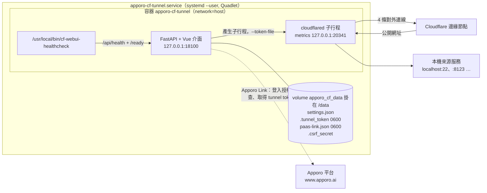

<p align="center">
  
</p>

<h1 align="center">Apporo CF Tunnel Web</h1>

<p align="center">
  <strong>用瀏覽器執行 Cloudflare Tunnel，並連結 Apporo 的 Security Access。單一容器，透過 Podman Quadlet 交給 systemd 監管。</strong>
</p>

<p align="center">
  <a href="README.md">English</a> &bull;
  <a href="#安裝">安裝</a> &bull;
  <a href="#連結-apporo-security-access">連結</a> &bull;
  <a href="#日常操作">操作</a> &bull;
  <a href="#安全性">安全性</a> &bull;
  <a href="#api-參考">API</a>
</p>

<p align="center">
  
  
  
  
  
  
  
  
  
</p>

---

## 概述

Apporo CF Tunnel Web 是
[WOOWTECH/Woow_cloudflare_tunnel_webgui](https://github.com/WOOWTECH/Woow_cloudflare_tunnel_webgui)
的 Apporo 版，從上游 1.2.1 分支而來。上游能做的它都能做，差別在平台連結連到哪裡：
**Apporo Link** 頁面會把這台主機連到 Apporo 平台（[www.apporo.ai](https://www.apporo.ai)）上的
**Security Access**（安全存取服務），而不是 WOOW PaaS。

單一容器同時執行 FastAPI + Vue 的網頁介面，**以及它以子行程監管的 `cloudflared` 連接器**。
連結 Apporo Security Access、貼上 tunnel token，或在介面上登入 Cloudflare，隧道就會運作。
不需要 Podman socket、不需要第二個容器，也不需要下指令。

功能與上游 1.2.1 相同，而上游 1.2.1 又與 WOOW 的 Cloudflared Home Assistant add-on 1.1.1 一致：
平台引導連結（逐條路由檢查公開或受 Access 保護）、邊緣連線狀態、日誌遮罩、run parameter 白名單，
以及憑證檔防護。需要 HA Supervisor 的功能只在 add-on 提供，包括 Ingress、`external_hostname`
與 `nginx_proxy_manager`；在這裡改用路由或 catch-all 即可達到相同效果。

`scripts/install.sh` 會把它安裝成 **rootless Podman Quadlet 單元，由使用者層級的 systemd 管理**：
開機自動啟動（需 linger）、當掉會自動重啟，**後端還活著但隧道死掉時也會自救**。

它可以和 WOOW 的網頁介面裝在同一台主機上，所有名稱、連接埠與 volume 都不同
（見[與 WOOW 版並存](#與-woow-版並存)）。



**存活偵測。** 容器健康檢查要求後端 `/api/health` 正常；隧道已設定時，還要求 cloudflared
`/ready` 至少有一條邊緣連線。啟動寬限 60 秒後每 30 秒檢查一次，連續三次失敗 podman 就會殺掉容器
（`HealthOnFailure=kill`），`Restart=always` 再把它拉回來，應用程式隨即重新接上隧道。
從偵測到恢復大約 1.5–2.5 分鐘。

## 與上游的差異

| | 上游 1.2.1（WOOW） | 本分支 1.0.0（Apporo） |
|---|---|---|
| 平台連結 | WOOW PaaS，`https://aiot.woowtech.io` | Apporo Security Access，`https://www.apporo.ai` |
| 在平台上的裝置名稱 | `Woow Cloudflared (Podman)` | `Apporo CF Tunnel Web (Podman)` |
| OAuth client、scope、API 路徑 | `woow-ha-smart-home`；`workspace:read security-access:read security-access:tunnel` | 不變 |
| 介面 | 繁體中文與英文混合，Cloudflare 橘色 `#F6821F` | 英文，Apporo 金色 `#8B6B24` |
| systemd 單元／容器 | `woow-cf-tunnel.service`／`woow-cf-tunnel` | `apporo-cf-tunnel.service`／`apporo-cf-tunnel` |
| 設定檔 | `~/.config/woow-cf-tunnel/woow-cf-tunnel.env` | `~/.config/apporo-cf-tunnel/apporo-cf-tunnel.env` |
| 映像檔標籤 | `localhost/woow-cf-tunnel:<VERSION>-<sha12>` | `localhost/apporo-cf-tunnel:<VERSION>-<sha12>` |
| 資料 volume（預設） | `cf_data` | `apporo_cf_data` |
| 介面／metrics／驗證代理 | `127.0.0.1:18000`／`:20241`／`:8888` | `127.0.0.1:18100`／`:20341`／`:8988` |
| 舊部署遷移 | `scripts/migrate-legacy.sh` | 沒有；絕不碰 WOOW 的任何資源 |

## 環境需求

- Ubuntu 24.04 或同等系統，**rootless podman 4.9.3 以上**（`sudo apt install podman`）
- 使用者 systemd session 並開啟 linger（`sudo loginctl enable-linger $USER`）
- 有 Security Access 的 Apporo 帳號，或任一 Cloudflare tunnel token，或可用介面登入流程的
  Cloudflare 帳號
- git，以及約 250 MB 建置映像檔的空間

## 安裝

```bash
git clone https://github.com/WOOWTECH/apporo_cf_tunnel_web.git
cd apporo_cf_tunnel_web

scripts/install.sh          # 第一次執行：建立 ~/.config/apporo-cf-tunnel/apporo-cf-tunnel.env 後停下
$EDITOR ~/.config/apporo-cf-tunnel/apporo-cf-tunnel.env
scripts/install.sh          # 建置映像檔、安裝單元、啟動並跑冒煙測試
```

映像檔從這份 checkout **在本機建置**，標籤是 `localhost/apporo-cf-tunnel:<VERSION>-<git-sha12>`，
unit 以 `Pull=never` 釘死該標籤。和上游 1.1.0 之後一樣，本 repo 只支援 Quadlet，沒有 compose 檔。

`~/.config/apporo-cf-tunnel/apporo-cf-tunnel.env` 只放安裝時的設定，沒有任何祕密：

| 設定 | 預設值 | 用途 |
|---|---|---|
| `CF_DATA_VOLUME` | `apporo_cf_data` | 要建立的資料 volume，重裝時沿用同一個。絕不要指向 WOOW 的 volume（例如 `cf_data`）；已存在的 volume 只有在 podman 顯示它屬於本應用程式時才會沿用 |
| `UVICORN_PORT` | `18100` | 介面／API 連接埠；unit 一律綁在 127.0.0.1 |
| `CF_METRICS_ADDR` | `127.0.0.1:20341` | cloudflared `--metrics`，必須留在 loopback |
| `AUTH_LISTEN` | `127.0.0.1:8988` | 選配 Basic-auth 代理的監聽位址 |
| `AUTH_HTPASSWD` | `%h/.config/apporo-cf-tunnel/htpasswd` | 其密碼檔 |

這些值在安裝時寫進 unit 檔，容器本身不會讀這個檔案。改完之後，執行 `scripts/upgrade.sh`
（隧道）或 `scripts/install.sh`（驗證代理）套用。`install.sh` 會拒絕已被其他程序佔用的連接埠，
也會拒絕 WOOW 的預設連接埠（18000、20241、8888），即使當時沒有程序佔用；它會指出是哪個連接埠。

### 開啟介面

它只監聽 127.0.0.1。在自己的電腦上：

```bash
ssh -L 18100:127.0.0.1:18100 <這台主機>
# 然後開啟 http://localhost:18100
```

接著連結 Apporo Security Access（見下一節）、在 Config 頁貼上 tunnel token，或在 Setup 頁登入
Cloudflare。

## 連結 Apporo Security Access

Security Access 是 Apporo 平台的隧道服務：平台會建立 Cloudflare tunnel 與它的公開網址
（應用路由），並可為每條路由加上 Cloudflare Access 保護。這個介面負責在你的主機上執行它的連接器。

請先在 [www.apporo.ai](https://www.apporo.ai) 建立 Security Access：工作區、方案，以及至少一條路由。
方案、試用與付款都在平台上處理，這個介面不會扣任何款項。

有兩種連結方式。

### 方式一：Apporo Link 頁面（建議）

1. **登入授權。** 在導覽列開啟 **Apporo Link**，取得裝置授權碼（device code）。開啟頁面提供的
   裝置授權頁（由平台回傳，即 `https://www.apporo.ai/device`），登入你的 Apporo 帳號、輸入授權碼
   並允許連線。授權碼最長 15 分鐘有效，頁面會自動更新。這個頁面不會要求你貼 tunnel token。
2. **選擇 Security Access。** 先選工作區，再選 Security Access。工作區裡還沒有服務時，頁面會
   提供前往平台建立的連結。
3. **檢查路由。** 允許連結之前，頁面會檢查服務與每一條路由：
   - 服務已啟用、訂閱有效，且 tunnel 已建立；
   - 沒有綁定其他裝置，也沒有第二個連接器；
   - 每條路由都有公開網址與內部服務網址；
   - **啟用** Access 的路由需要有 Access 席次的方案、至少一種登入方式，以及指名特定 Email
     或 Email 網域的允許規則；過寬的規則（所有人、IP 範圍、國家、bypass）會被拒絕；
   - **未啟用** Access 的路由（公開路由）不需要席次，但任何知道網址的人都能連到你的服務，
     所以該服務必須自己開啟登入。頁面會列出這些路由，並要求你確認後才連結。

   依頁面提示到平台修正（路由在 Security Access 的 **Application** 分頁，保護設定在 **Access**
   分頁），再重新檢查。
4. **連結。** 頁面會再檢查一次，接著取得 tunnel 憑證、以 `Apporo CF Tunnel Web (Podman)`
   的名稱在平台上綁定這台主機，並以 token 模式啟動 cloudflared。啟動失敗時，會還原先前的本機設定
   並解除綁定。

連結後，頁面可以刷新連線狀態，並從外部測試公開網址。測試是匿名請求，只會顯示網址回應的是
Access 登入頁、公開回應、封鎖或來源錯誤，不代表指定的人能成功登入。修改路由的保護設定後，
平台要等有連接器在線才會發布變更；發布前網址會回 503，頁面會把該路由標示為 *awaiting publication*
（等待發布）。

連結期間，Config 頁的 token 與模式會被鎖定。在 Apporo Link 頁面**解除連結**時，會停止
cloudflared 並確認它已結束、移除 token、清空本機路由，再到平台解除綁定。若平台暫時連不上，
解除綁定會維持待完成：頁面提供重試按鈕，應用程式下次啟動時也會自動重試。解除連結不會刪除公開網址、
DNS 紀錄、Access 設定或訂閱，這些請到平台處理。

沒有任何連結時，可以在同一頁撤銷帳戶授權。

### 方式二：貼上 tunnel token

1. 在 [www.apporo.ai](https://www.apporo.ai) 開啟你的工作區，再開啟該 Security Access。
   在 **Overview** 分頁找到 **Connect a machine** > **Tunnel token**，顯示或複製 token。
   請把它當成密碼保管。
2. 在介面開啟 **Config**，把 **Mode** 設成 `token`，將 token 貼到 **Tunnel Token**
   （貼整段 `cloudflared service install …` 指令也可以），再按 **Save & Apply**。

token 模式下，路由由平台提供：請在平台的 Application 分頁管理，Config 頁的本機路由不會使用。
token 存在 `/data/.tunnel_token`（權限 0600），之後只會顯示成 `********`。要停用時，在 Config
頁移除 token 即可。設定了手動貼上的 token 時，Apporo Link 頁面會拒絕連結；若要改用 Apporo Link，
請先移除 token。

同一把 token 一次只在一台機器上執行。兩個連接器跑同一把 token 時，Cloudflare 可能把訪客送到其中
任何一台，而且常常是舊的那台。新的連接器上線後，請立刻停掉舊的。

### 路由的內部網址

cloudflared 以 host 網路執行，所以路由的內部服務網址要填這台主機上的服務，例如
`http://localhost:8123`（Home Assistant）或 `http://localhost:80`（Nginx Proxy Manager）。
502 通常表示該連接埠沒有服務在監聽，可在主機上用 `curl -I http://localhost:<連接埠>` 檢查。
Home Assistant 回 400 表示它拒絕經反向代理轉來的請求：在它的 `http:` 設定加上 `use_x_forwarded_for: true`，
並把 `127.0.0.1` 與 `::1` 加入 `trusted_proxies`。

### 使用自己的 Cloudflare 帳號

不用 Apporo 也可以照上游的方式使用：在 Config 頁貼上 Cloudflare 後台的任一 tunnel token
（token 模式），或在 Setup 頁登入 Cloudflare、建立 tunnel，並從這台主機管理路由與 DNS
（本地管理模式）。

## 與 WOOW 版並存

本分支可以安裝在已經執行 WOOW Cloudflare Tunnel Web GUI 的主機上，兩邊沒有任何共用的單元、容器、
volume、連接埠或檔案：

- 單元與容器：`apporo-cf-tunnel`（WOOW：`woow-cf-tunnel`）
- 映像檔：`localhost/apporo-cf-tunnel`（WOOW：`localhost/woow-cf-tunnel`）
- 資料 volume：`apporo_cf_data`（WOOW：`cf_data`）
- 連接埠：18100／20341／8988（WOOW：18000／20241／8888）
- 目錄：`~/.config/apporo-cf-tunnel`、`~/.local/state/apporo-cf-tunnel`、
  `~/backups/apporo-cf-tunnel`。vendored 的 Quadlet 函式庫會把各應用程式的安裝清單與鎖放在
  `~/.local/state/woow-quadlet/` 底下各自的子目錄（這裡是 `apporo-cf-tunnel/`）。

**沒有舊部署遷移。** Apporo 的腳本絕不偵測、停止、接管、遷移或移除任何屬於 WOOW 的東西：
`woow-*` 單元與容器、`cf-tunnel-webgui*`、`cf_data` volume，以及 `~/.config/woow-cf-tunnel`。
全新安裝會從一個屬於自己的空 volume 開始，請維持這樣：若把 `CF_DATA_VOLUME` 指向 WOOW 的
volume，兩個介面會搶同一把 token。

任何指向 WOOW 安裝的設定值，腳本都會在改動任何東西之前拒絕：

- `CF_DATA_VOLUME` 是 WOOW 的 volume 名稱（`cf_data`、`<project>_cf_data`、`woow*`、
  `cf-tunnel-webgui*`）、`AUTH_HTPASSWD` 位於 `~/.config/woow-cf-tunnel`，或 `--image` 指定
  WOOW 的映像檔；
- `UVICORN_PORT`、`CF_METRICS_ADDR` 或 `AUTH_LISTEN` 用了 WOOW 的預設連接埠 18000／20241／8888，
  即使 WOOW 的介面當時沒有執行也一樣。否則它的介面與連接器下次啟動時就綁不到這些連接埠，
  它的隧道會一直斷線；
- 已存在、但 podman 顯示不屬於本應用程式的 volume，不論名稱為何：標記為其他應用程式所有
  （WOOW 的 Quadlet volume 帶有 `io.woowtech.app=woow-cf-tunnel`）、由 compose 建立，或被
  `apporo-cf-tunnel` 以外的任何容器掛載（不論執行中或已停止）。`install.sh`、`backup.sh`、
  `restore.sh` 與 `uninstall.sh --purge` 在使用 volume 之前都會檢查，否則 Quadlet 會默默沿用
  同名的 volume；
- `auth-passwd.sh` 搭配 `ENV_FILE=<WOOW 的 env 檔>`，不論那個檔案指定哪個 htpasswd；
- `--stage-dir` 位於 WOOW 的目錄。`install.sh --stage` 會整個換掉該目錄，所以裡面除了先前的
  stage 之外還有其他東西時也會拒絕；
- `restore.sh` 的 tarball 是 WOOW 的備份：依所在目錄（`~/backups/woow-cf-tunnel`）或檔名
  標示的來源 volume（`cf_data-<時間戳>.tar`）判斷。這種備份裡有 WOOW 的 tunnel token。
  反過來，`backup.sh --dir` 也絕不寫進 WOOW 的目錄；
- `upgrade.sh swap|status|commit|abort|--rollback` 指定 WOOW 的升級紀錄目錄、
  `CF_STATE_ROOT` 指向 WOOW 的狀態目錄，或升級紀錄的 `run.env` 列出本應用程式以外的單元或容器。

腳本停止、啟動與檢查的單元和容器是固定的：`apporo-cf-tunnel.service` 與 `apporo-cf-tunnel`。
shell 裡 export 的 `NEW_UNIT` 或 `NEW_CONTAINER`（例如為了調整 WOOW 自己的升級）會被忽略，
`METRICS_ADDR` 也一樣：`uninstall.sh` 會到已安裝 unit 使用的位址計算邊緣連線數。

已被其他程序占用的連接埠也會被拒絕，`--stage` 和隧道執行中都一樣。`upgrade.sh` 用目前執行中隧道
安裝時的連接埠取得基準（回復時也一樣），新的連接埠只用在閘門檢查。`tests/smoke.sh` 只檢查
本應用程式自己的 cloudflared：WOOW 舊版 `cf-tunnel-webgui` 的連接器會在命令列帶 `--token`，
這只會列出提醒，不算本安裝的失敗。

兩個介面可以在同一個瀏覽器裡同時使用。瀏覽器在同一台主機的各個連接埠之間共用 cookie，
所以本介面的 CSRF cookie 叫做 `apporo_csrftoken`，WOOW 的是 `csrftoken`。

要把目前由 WOOW 介面執行的隧道搬過來（例如在本分支出現之前，貼到那邊的 Apporo token），
請先在這裡連結；等這裡的 Dashboard 顯示有邊緣連線後，立刻從 WOOW 介面移除那把 token。

## 日常操作

```bash
systemctl --user show apporo-cf-tunnel.service -p ActiveState,SubState,NRestarts
journalctl --user -u apporo-cf-tunnel.service -n 50
podman inspect apporo-cf-tunnel -f '{{.State.Health.Status}}'
curl -s 127.0.0.1:20341/ready            # {"status":200,"readyConnections":4}
tests/smoke.sh                           # 完整的安裝後檢查
```

> **如果 SSH 是走這條隧道進來的，重啟會把你自己斷線。** `scripts/install.sh` 永遠不會重啟
> 執行中的隧道；`scripts/upgrade.sh` 則由背景監看程式執行重啟，失敗會自動回滾。
> 遠端操作前，一定要先確保有第二條路（tailnet、區域網路或實體主控台）。
>
> `upgrade.sh`、`uninstall.sh`、`restore.sh` 會用 `ss -tnpH "sport = :<用戶端埠>"`
> 查出「是哪個本機行程握著這條 SSH 連線的本機端」，藉此判斷你走的是哪條路。tailscaled 以
> `--tun=userspace-networking` 執行時同樣會改連 127.0.0.1:22，所以光看來源位址是 loopback
> 什麼都證明不了，只有載送行程（`cloudflared` 或 `tailscaled`）能分辨。查不出載送行程時，
> 一律當作你走在隧道上並說明依據。判定走在隧道上時，`uninstall.sh` 與 `restore.sh` 會拒絕
> 執行，除非加上 `--force`；`upgrade.sh` 只會警告並繼續，因為即使你斷線，它的監看程式也會完成
> 或回滾。

**已知行為（Known behaviour）：** 當你的 ISP 或邊緣節點連不上時，健康檢查會大約每兩分鐘殺掉並
重啟容器一次，直到連線恢復。從介面按下停止隧道也會被同樣機制還原——在「隧道就是遠端路徑」的主機上，
這是刻意的取捨。

## 升級

要更新到新版本：`git pull` 後執行 `scripts/upgrade.sh`。要部署自己的修改：修改 repo（調整
`VERSION`、釘選的 `CLOUDFLARED_VERSION`、unit 或設定），commit，然後：

```bash
scripts/upgrade.sh
```

有未 commit 修改的 checkout 會被拒絕，因為它的映像檔標籤無法對應到實際執行的內容。腳本會在舊容器
持續服務時建置新映像檔，把目前安裝的 unit 存成回滾目標，備份資料 volume，並記錄基準：邊緣連線數、
ingress 設定版本、主機名稱對應表、每個公開網址的 HTTP 回應碼。接著把重啟交給背景的
`systemd-run --user` 監看程式：安裝 → 重啟 → **180 秒內通過閘門檢查** → **觀察 600 秒** → 定案。
定案前任何失敗、逾時或訊號，都會重新安裝先前的 unit 並重啟。
`scripts/upgrade.sh status|commit|abort|--rollback` 可追蹤、提早結束觀察期或還原。

## 備份與還原

```bash
scripts/backup.sh                      # ~/backups/apporo-cf-tunnel/<volume>-<時間>.tar（含 .sha256）
scripts/restore.sh <tar 檔> [--replace]
```

> 這個 tar 檔包含 `/data`，**裡面有 tunnel token**；用過 Apporo Link 之後，也包含平台的
> OAuth refresh token（`paas-link.json`）。檔案權限 0600、目錄 0700。請留在本機、定期刪除舊檔，
> 也絕對不要未加密就往外複製：拿到它的人就能接管你的隧道。

## 移除

```bash
scripts/uninstall.sh            # 停止並移除 unit；保留 volume 與映像檔
scripts/uninstall.sh --purge    # 先做最後一次備份，再刪掉 volume
```

移除會停止隧道，它服務的所有公開網址都會中斷。它絕不會動到同一台主機上的 WOOW 介面。

## 安全性

- **這個介面沒有登入機制。** 任何連得到它的人都能讀取 ingress 設定、替換 tunnel token，
  或停掉隧道。**沒有加上驗證之前，絕對不要把它掛上公開網址或區域網路。**
  建議順序：
  1. SSH 埠轉發（預設：unit 綁 127.0.0.1，`tests/smoke.sh` 一旦發現其他位址監聽就會失敗）；
  2. 在 tunnel 網址前面加上 **Cloudflare Access**（用 Apporo 時：建立一條指向
     `http://localhost:18100`、受 Access 保護並設定 Email 允許名單的路由）；
  3. 選配的 Basic-auth 代理：`scripts/auth-passwd.sh <使用者>` 之後執行
     `scripts/install.sh --with-auth`（nginx 監聽 `AUTH_LISTEN`，安裝時驗證 htpasswd 格式，
     接受 bcrypt、SHA-512／SHA-256 crypt 與 apr1；unit 以 Assert 檢查檔案存在，不會陷入重啟迴圈）。
- **tunnel token 是應用程式狀態，不是 repo 裡的祕密。** 它放在資料 volume 的
  `/data/.tunnel_token`（權限 0600），因為「設定與更換 token」正是這個介面的功能。
  cloudflared 以 `--token-file` 讀取，所以**不會出現在任何行程參數裡**：
  `ps`、`podman top`、`systemctl --user status` 都看不到它。API 一律只回傳 `********`。
- **Apporo 的登入授權只留在後端。** Apporo Link 的 OAuth token 存在 `/data/paas-link.json`
  （權限 0600）。只有後端會處理它們與 tunnel 憑證，瀏覽器只拿到導覽網址與不含祕密的摘要。
  平台來源網址固定寫在映像檔裡（`https://www.apporo.ai`），平台回傳的裝置授權頁若不在該網域的
  `/device`，登入會被拒絕。
- **repo 與 unit 檔內沒有任何祕密。** `config/apporo-cf-tunnel.env.example` 只有設定值，
  CI 會執行 `tests/no-secrets.sh`。
- 容器以 rootless 執行，`--cap-drop=all` 且 `no-new-privileges`。metrics 位址必須留在
  127.0.0.1：在 host 網路模式下，`0.0.0.0` 會把整份 ingress 對應表公開給區域網路
  （install.sh 會拒絕）。
- 備份檔含有上述 token（見上）。

## 專案結構

```
quadlet/          apporo-cf-tunnel.container、apporo-cf-tunnel-data.volume、render-vars
quadlet/optional/ apporo-cf-tunnel-auth.container（Basic-auth 代理）
config/           apporo-cf-tunnel.env.example、auth/auth-nginx.conf
scripts/          install、upgrade、uninstall、backup、restore、auth-passwd、
                  healthcheck.py、render-args.sh、lib/
backend/          FastAPI：routers/{config,tunnel,logs,health,setup,paas}、
                  services/{process_manager,cloudflared_cli,token_store,config_builder,
                  config_manager,instances,validator,...}
frontend/         Vue 3 + Vite SPA
tests/            dryrun.sh（含 dryrun.local.sh）、smoke.sh、harness/、pytest 測試
docs/             上游的設計文件與截圖
```

`scripts/lib/quadlet-lib.sh` 是 WOOWTECH 共用的 Quadlet 函式庫，與上游同一個檔案、原封不動
vendored 進來，CI 會比對雜湊。請勿在這裡修改它；裡面的 WOOW 字樣只是註解與通用名稱。
`scripts/lib/quadlet-lib.versions` 是已發布 `(版本, sha256)` 對照的正式帳本，`tests/lib-version.sh`
會拿 vendored 的函式庫去對它：單靠 manifest 只能證明檔案複製過來之後沒被改過，無法證明它到底是
哪一個版本。

## 測試

```bash
tests/dryrun.sh            # 套值 + podman 4.9.3 產生器 + systemd-analyze + 不變條件
tests/harness/run-all.sh   # 以模擬的 podman/systemd 跑 install/upgrade/uninstall
python -m pytest -m "not e2e" -q
(cd frontend && npx vitest run && npm run build)
tests/smoke.sh             # 針對實際安裝
```

`tests/dryrun.sh` 與 `tests/harness/run-all.sh` 需要 podman 的 Quadlet 產生器
（`/usr/libexec/podman/quadlet`）與 shellcheck，CI 會安裝。除了 CI 的端對端工作，沒有任何測試會
建立容器；那個工作同時驗證存活鏈（假 token → 不健康 → `HealthOnFailure=kill` → `Restart=always`）。

## API 參考

| 端點 | 回傳 |
|---|---|
| `GET /api/health` | `version`、`process_running`、`stopped_by_operator`、`tunnel`（`status`：running / starting / stopped，`ready_connections` 取自 cloudflared `/ready`）、`credentials_error` |
| `GET /api/config` | `TunnelConfigRead`：`mode`、`tunnel_name`、`routes[]`、`catch_all_service`、`post_quantum`、`log_level`、`run_parameters[]`、`no_tls_verify`、`tunnel_token_masked`、`tunnel_token_set`、`tunnel_token_managed_by_paas` |
| `PUT /api/config[?restart=true]` | 同樣結構。`tunnel_token` 只能寫入：省略或 `null` 保留、`""` 移除、給值（或貼上 `cloudflared service install …` 指令）則取代，存到 `/data/.tunnel_token`。加上 `restart=true` 會同時套用設定 |
| `POST /api/tunnel/{start,stop,restart}`、`GET /api/tunnel/status` | 連接器控制；start 與 restart 都以目前設定重建 argv |
| `GET /api/setup/state`、`POST /api/setup/*`、`WS /api/setup/login` | 本地管理上線精靈（token 模式會拒絕） |
| `GET /api/paas/bootstrap`、`/authorization[/status、/revoke]`、`/workspaces[/{id}/accesses]`、`/accesses/{id}/review`、`/accesses/{id}/connect`、`/connection/status[?probe=true]`、`/disconnect[/finish]` | 連到 www.apporo.ai Security Access 的 Apporo Link（與上游的 WOOW PaaS 連結及 HA add-on 相同的契約） |
| `GET /api/logs`、`WS /ws/logs` | cloudflared 輸出（已遮罩憑證）：快照與即時串流 |

會改變狀態的請求需要 CSRF double-submit token：把 `apporo_csrftoken` cookie 的值放進
`x-csrftoken` 標頭送回。cookie 名稱刻意不用 starlette-csrf 預設的 `csrftoken`，本介面與
WOOW 的介面才能在同一個瀏覽器裡並用。

## 截圖

目前還沒有 Apporo 介面的截圖。[`docs/screenshots/`](docs/screenshots/) 裡是上游的圖片，
畫面是 WOOW 的早期版本，頁面、品牌與 token 存放方式都和本分支不同。說明見
[`docs/screenshots/README.md`](docs/screenshots/README.md)。

## 支援

- 問題回報：[GitHub Issues](https://github.com/WOOWTECH/apporo_cf_tunnel_web/issues)
- 上游專案：[WOOWTECH/Woow_cloudflare_tunnel_webgui](https://github.com/WOOWTECH/Woow_cloudflare_tunnel_webgui)
- 變更紀錄：[CHANGELOG.md](CHANGELOG.md)

## 授權

MIT。Copyright (c) 2026 WOOWTECH（上游）與 (c) 2026 Apporo（分支修改），詳見 [LICENSE](LICENSE)。

---

<p align="center">
  Apporo CF Tunnel Web 建立在 <a href="https://github.com/WOOWTECH">WOOWTECH</a> 的 <a href="https://github.com/WOOWTECH/Woow_cloudflare_tunnel_webgui">Woow_cloudflare_tunnel_webgui</a> 之上，以 Vue 3 + FastAPI + Podman Quadlet 打造
</p>
